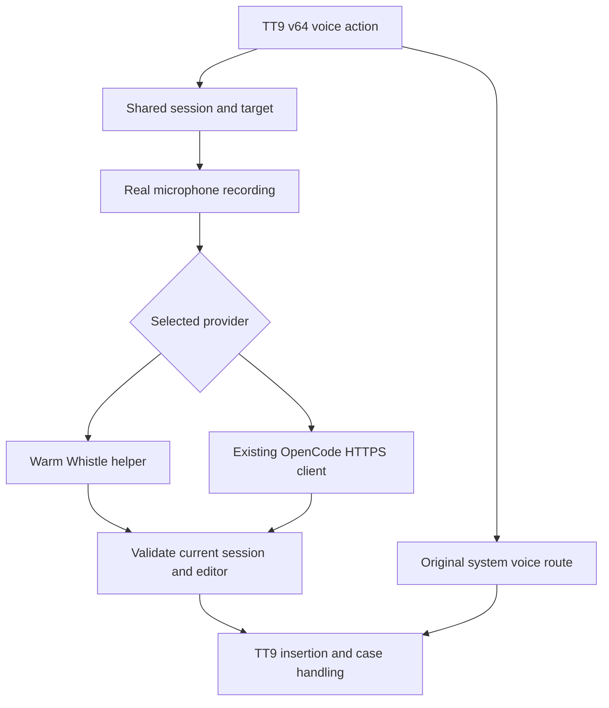
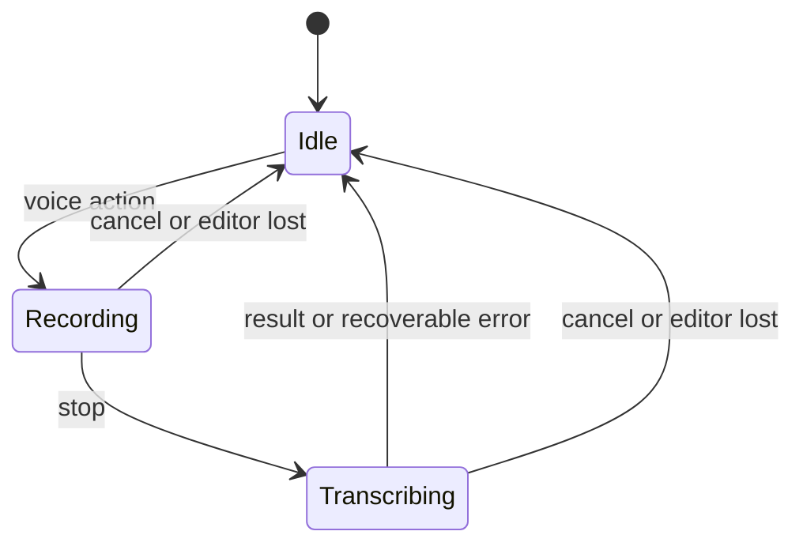

# TT9 v64 Qin Dictation - Plan

## Goal Capsule

- **Objective:** Max can comfortably type or dictate into everyday text fields on the Qin F22.
- **Means:** TT9 v64 with one shared dictation pipeline, a bundled Whistle runtime, and an optional OpenCode client (KTD1–KTD4).
- **Authority:** Current owner instructions and this Product Contract govern scope; the workspace device boundaries in `../../AGENTS.md` and `../../HANDOFF.md` remain binding.
- **Execution profile:** Preserve existing work, prove the microphone path early, deliver a usable phone build, then select the Whistle configuration from measured results.
- **Stop conditions:** Do not write to an unidentified/disconnected phone, proceed through an unhealthy boot, publish private artifacts, or substitute fixture transcription for a real microphone test.
- **Delivery owner:** The implementing agent owns the build, reversible installation, verification and evidence. Max supplies real speech and judges the small-screen experience.

---

## Product Contract

### Summary

Use the TT9 v64 feature set as the keyboard base, add integrated dictation, and make its settings comfortable on the Qin's small screen.
Choose a voice provider first, then tailor only that provider's options.
Select Whistle's default configuration through a repeatable phone benchmark; reuse the existing OpenCode client without bundling another inference runtime.

### Problem Frame

The previous v34 fork built and was staged on the phone, but successful registration and real microphone-to-editor transcription were not verified.
Earlier emulator tests used supplied audio and could not establish usable speech capture.
Max also saw missing settings compared with v64, and wants the newer keyboard's capabilities, clearer menus and a measured balance of speed, accuracy and resource use.
The phone is now reported working again; the cause of its disappearance after the previous reboot remains unknown.

### Requirements

**Keyboard and dictation**

- R1. Base the fork on TT9 v64.0 and retain its features, languages, settings and keypad behaviour, except for the requested additive dictation and menu changes.
- R2. The voice action records the real microphone, stops on the next voice action and inserts the resulting text once at the original editor's cursor without sending it.
- R3. Cancellation, keyboard dismissal or an editor change suppresses subsequent insertion; failures leave the keyboard usable for retry and normal typing.
- R4. Silence produces no invented message, and legitimate speech is not removed by a phrase blacklist.

**Voice choices and personalisation**

- R5. Offer Whistle, OpenCode/MiMo and TT9's original system voice pathway; Whistle is the initial default and no automatic cloud fallback is allowed.
- R6. Provider selection reveals that provider's relevant settings, preserves independent saved values when switching, and shows readiness and recoverable errors.
- R7. Whistle exposes measured performance choices with understandable speed/accuracy descriptions, English initially selected, and optional keyword hints only where the actual runtime supports them.
- R8. OpenCode offers key entry/import/removal, cleanup instructions and advanced endpoint/model fields, reusing the existing audio request contract; it must not require the standalone app.

**Small-screen experience**

- R9. Improve the settings' visual hierarchy and navigation for the actual Qin display, with readable text, clear D-pad focus, touch access, short labels and consistent Back behaviour.
- R10. All v64 settings remain reachable; disclosure of advanced controls reduces clutter without deleting functionality or silently resetting values.

**Performance and delivery**

- R11. Benchmark Whistle's supported configurations on the physical Qin using identical clips, reporting transcription accuracy, cold/warm delay and memory before choosing a default.
- R12. Retain the loaded Whistle model between normal consecutive dictations where memory permits; release resources when appropriate and recover after process death.
- R14. Bundle English typing and English word-pair data for offline use; retain every other language choice with downloads available, avoiding the full dictionary payload on this phone.
- R13. Keep stock TT9 available, preserve its data, install reversibly, and verify the actual installed artifact and healthy boot before declaring delivery.

### Acceptance Examples

- AE1. Covers R2–R4. Real speech in two ordinary editors inserts once; cancel, field changes and silence insert nothing.
- AE2. Covers R5–R8. Selecting OpenCode reveals its saved configuration; switching to Whistle hides cloud controls and makes no network request.
- AE3. Covers R9–R10. On the Qin, Max can navigate settings, edit and save provider controls, and return using the keypad without clipped actions or losing focus.
- AE4. Covers R11–R12. Identical speech clips produce a report that exposes speed/accuracy/memory tradeoffs, and consecutive warm dictations do not reload the model each time.

### Scope Boundaries

- Include a bounded polish of native settings navigation, common preference presentation and the new voice screens; preserve the typing surface's existing behaviour.
- OpenCode is an optional network adapter, not a second bundled inference runtime or a new remote hosting service.
- No firmware, package-manager gate, boot image, browser/Play policy or unrelated app work.
- No automatic settings/database migration from stock TT9. The separate fork retains its own settings; use supported export/import where helpful and explain any manual setup.
- Do not add speculative CPU governors, system tuning, new background services or an automatic tuning wizard; benchmark during implementation and ship the measured choices.
- Defer streaming partial dictation, model training, a hosted Whistle endpoint and an arbitrary provider/plugin framework.

---

## Planning Contract

### Key Technical Decisions

- KTD1. **Port onto pinned v64.0, not the other way around.** Use upstream commit `e9f37e49ef9698cc78a61def709c191661e2fa25`. Preserve the dirty v34 tree and its artifacts before starting a separate implementation checkout. The original fork's voice classes must not replace v64's newer classes wholesale. Governs R1, R13. (session-settled: user-approved — chosen over v34: retain the newer TT9 options after checking Android compatibility.)
- KTD2. **One shared dictation controller with small provider adapters.** Reuse recording, session identity, silence handling, status and editor insertion for Whistle and OpenCode. Keep TT9's existing system-voice route intact behind the same selection UI; Android's system recognizer owns its own capture. Snapshot provider and target at session start. Governs R2–R6.
- KTD3. **Retain the existing runner through an app-private FIFO.** The supported C API has no depth/thread controls, so do not add a native wrapper or call private C++ symbols. The runner loads its model before waiting on an ordinary WAV FIFO; this was proven on the Qin using a temporary root-owned pipe, with app-UID permission still to verify. Keep one idle prepared process, feed complete WAV on stop, reap it after the final result, then prepare the next idle process. Use nonblocking FIFO open/write, a bounded overall deadline and process cleanup to make cancellation safe. Low-memory callbacks release the idle process. Governs R3, R12.
- KTD4. **Reuse the proven OpenCode audio client.** Adapt `../qin-dictation/src/main/java/au/max/qindictation/TranscriptionClient.java` and its tests, using platform HTTPS/JSON and a distinct fork-specific Keystore alias. Preserve thinking-disabled requests, bounded timeouts, cancellation and HTTPS credential handling. It adds no local model. Integrate only after the Whistle microphone path works; if reuse exposes a service/API redesign, report that evidence rather than expanding into it. Governs R5, R8.
- KTD5. **Tune the same Whistle weights through supported runner controls.** The retained model supports speech depths 2–8, with 8/full equivalent, and `--threads` accepts excessive values without validation. Clamp profiles to that model range and 0/auto or 1–4 threads. A 27-run screen and 117-run expanded synthetic-fixture comparison favour four threads and provisionally four layers for balance; keep full-depth accuracy and faster two-layer alternatives visible with honest tradeoffs. Verify app-UID warm timings before claiming a warm-path gain. Governs R7, R11.
- KTD6. **Native compact settings, not a web UI.** Extend v64's preference screens and shared theme: restrained neutral surfaces, one accent, strong type hierarchy and visible focus. Use a single column, short primary labels and concise current-value summaries. Put Voice input near the main keyboard settings, with a provider chooser followed by provider controls and a separate Advanced screen for infrequent edits. Derive dimensions from the Qin's measured dp viewport and font scale, not assumed physical pixels. Governs R6, R9–R10.
- KTD7. **No hidden audio transfer.** Whistle remains offline with runner telemetry disabled or absent in the pinned build. OpenCode clearly states that recordings go to the configured endpoint. Never fall back between providers automatically. Do not log keys, transcripts or audio; private fixtures are retained only for deliberate testing. Governs R5, R8, R13.

- KTD8. **Keep v64 functionality with compact language packaging.** The loader tries bundled ZIPs before remote downloads in either flavor. Build the lite flavor with English dictionary/ngrams bundled and the full shared language metadata. Use the official v64 generated assets, validated against SHA-256 `b13b93a129d945996b5c2b9dec7a9fd660cd26bf8855cfdb7a4780624d349bda`, rather than regenerating dictionaries during iteration. No other keyboard feature depends on the LITE flag. Governs R1, R14.

### Existing Evidence and Technical Constraints

- `../tt9-fork/CURRENT_STATE.md`, `../tt9-fork/README.md` and `../../HANDOFF.md` describe the earlier v34 fork, deployment checksum and unverified post-reboot state. They are historical evidence, not proof the current device is ready.
- v64 `app/build.gradle` declares minSdk 24, compile/target SDK 37 and AGP 9.3.1; its wrapper is Gradle 9.5.0. Use the supported JDK and SDK combination for those pinned versions during implementation, preserving the upstream build rather than lowering requirements casually.
- v64 `ime/voice/VoiceInputOps.java` adds a provider picker, partial results and legacy/modern support; `ime/VoiceHandler.java` applies case handling and has changed inheritance. Preserve those paths and adapt only the Whistle/OpenCode integration.
- Retained native assets are in `../../work/whistle-test/bin/` and `../../work/whistle-test/models/`; the ARMv7 static library exists, but linking it into a persistent helper and running it from the app UID are untested.
- Existing cloud evidence is in `../qin-dictation/TESTING.md`, `../qin-dictation/LATENCY_NOTES.md` and `LATENCY_REPORT.md`. Endpoint viability is settled; copying credentials, changing request behaviour or citing old latency as current proof is not justified.
- The Qin was last verified as Android 11, 32-bit ARM and slot a. Phone compatibility must be checked again at implementation time. During the owner-authorized experimental continuation, Android 11/build 66.0.3, healthy boot/root, charging and the 480x640/208 dpi display were rechecked; the existing Android 11 emulator was also resized to match. The benchmark evidence is under `../../work/whistle-test/evidence-2026-10-16/`. Discard root-polling warm timings: Magisk logging created measurement load; retain only the FIFO feasibility result until app-UID timing is available.

### Technical Shape

Terminal callbacks recheck session identity on the main thread immediately before insertion, including callbacks queued after cancellation.
The original field may be revisited later, so package/field ID equality alone is insufficient to validate the editing session.

---

## Implementation Units

### U1. Preserve work and establish the v64 base

**Goal:** A separately identifiable v64 fork builds without losing existing work.
**Requirements:** R1, R13, R14; KTD1, KTD8.
**Dependencies:** None.
**Files:** `app/build.gradle`, `build.gradle`, `gradle/wrapper/gradle-wrapper.properties`, `app/src/main/AndroidManifest.xml`, `app/src/main/res/xml/prefs.xml`, `make-module.sh`, `README.md`, `docs/evidence/v64-baseline.md` (new).
**Approach:**

1. Preserve the dirty v34 checkout and record its hashes; use the separate local `tt9-whistle-v64` clone on a feature branch from the pinned upstream base.
2. Keep the side-by-side package identity and signing continuity so the existing fork can update without deleting its data. Audit hardcoded package references in intents, setup checks and v64's provider authority.
3. Build the compact release per KTD8 and make module generation derive its version and native assets from that artifact.

**Patterns:** v64 build/version scripts and current single-app module packaging.
**Test scenarios:** Release metadata identifies v64 and the fork; native code includes ARMv7; internal Help, Privacy, setup and picker intents resolve to the fork; stock TT9 remains separately available.
**Verification:** Successful release build, signature/ABI checks, and an explicit inventory mapping upstream settings entries to reachable fork entries. Packaging smoke checks are more useful than implementation-mirroring unit tests here.

### U2. Port real microphone dictation and session safety

**Goal:** Actual speech captured from the keyboard reaches the intended editor safely.
**Requirements:** R2–R4; AE1; KTD2.
**Dependencies:** U1.
**Files:** `app/src/main/java/io/github/sspanak/tt9/dictation/DictationEngine.java`, `dictation/Transcriber.java` under the same Java package, `ime/voice/VoiceInputOps.java`, `ime/VoiceHandler.java`, `ime/TraditionalT9.java`, `app/src/test/java/io/github/sspanak/tt9/dictation/DictationSessionTest.java` (new), `app/src/androidTest/java/io/github/sspanak/tt9/dictation/EditorDeliveryTest.java` (new).
**Approach:**

1. Adapt the current MIC/16 kHz recorder and terminal callbacks to v64's insertion/case handling, preserving its original system route.
2. Keep the current CLI runner as an initial baseline to prove microphone capture before replacing the runtime in U3.
3. Correct any observed lifecycle failures at the shared controller rather than duplicating safety logic in each provider. Keep fixture injection debug-only and visibly distinguish settings tests from recording.

**Test scenarios:**

- Covers AE1. Permission grant followed by real speech inserts once in each of two ordinary fields.
- Covers AE1. Cancel during recording, inference and a queued callback inserts nothing; switching fields and returning to the same field does not revive an old result.
- Silent audio returns no speech; a legitimate utterance containing “thank you” is not blacklisted.
- Missing mic permission, unavailable audio device and transcription failure show recoverable status; typing and a subsequent dictation still work.

**Verification:** A named real-microphone phone check, ordinary keypad typing and automated session tests all pass. Fixture-only/emulator evidence cannot complete this unit.

### U3. Keep Whistle warm and select a measured performance profile

**Goal:** Choose the fastest useful Whistle configuration without hiding accuracy or memory costs.
**Requirements:** R7, R11–R12; AE4; KTD3, KTD5.
**Dependencies:** U2.
**Files:** `app/src/main/java/io/github/sspanak/tt9/dictation/LocalWhistleTranscriber.java`, `app/src/main/java/io/github/sspanak/tt9/dictation/PreparedWhistleTranscriber.java` (new), `app/build.gradle`, `app/src/test/java/io/github/sspanak/tt9/dictation/WhistleWorkerProtocolTest.java` (new), `tests/whistle/benchmark.py` (new), `tests/whistle/manifest.json` (new), `docs/evidence/whistle-qin-benchmark.md` (new).
**Approach:**

1. Confirm the pinned runner/header/model provenance and its speech-specific controls. The public C API does not expose depth or threads; use the runner per KTD3 rather than assuming new setters.
2. Implement the prepared-runner lifecycle per KTD3; verify FIFO permissions under the real app UID before relying on the root-only feasibility experiment.
3. Benchmark supported audio depths of one model, then warm versus per-call loading. Add other runtime knobs only if the pinned engine really supports them and the comparison answers a measured bottleneck.
4. Package only the selected weights/runtime and small profile configuration; do not ship all benchmark candidates. Make profiles reflect measurements, not generic Fast/Balanced/Accurate labels without evidence.

**Benchmark protocol:** Use at least 12 reference-transcribed clips spanning short/long dictation, natural fillers, names/numbers, quiet speech and noise, plus separate silence fixtures. Include several real Qin microphone recordings and keep a small held-out subset unused for choosing the setting. Repeat each supported candidate at least three times in interleaved order; separate cold startup from warm runs. Record median/p95 stop-to-result time, model load time, combined IME/helper PSS and peak memory, failures, normalized word error rate, and errors in names/numbers/negation. Log only timings and scores in routine app diagnostics.

**Selection rule:** Reject crashes, unstable memory use, silence insertion and meaning-changing errors in the representative acceptance phrases. Among useful stable candidates, choose a Pareto-efficient default with the lowest warm delay at comparable accuracy. If a materially faster setting loses accuracy, retain it as an explicit alternative rather than silently choosing it. Report the tradeoff to Max when no candidate clearly balances both; do not manufacture a single winner from tiny WER differences.

**Test scenarios:**

- Covers AE4. Two consecutive jobs use the same loaded model; a new process or changed depth reloads predictably.
- Worker death, malformed output and timeout leave the keyboard responsive; cancelled work never inserts late and a subsequent job can recover.
- Profile selection persists, depth outside 2–8 and threads above four are rejected or restored to a valid saved choice, and process-global calls do not overlap.
- Low-memory teardown releases the helper; next dictation can reload. The benchmark includes normal typing/app switching alongside the warm helper.

**Verification:** Reproducible score table and hashes, held-out results, an explained default and working warm-path phone evidence. Do not promise a specific speedup before measurement.

### U4. Add the optional OpenCode adapter using existing code

**Goal:** Enable cloud dictation without a second local model/runtime.
**Requirements:** R3–R6, R8; AE2; KTD2, KTD4, KTD7.
**Dependencies:** U2.
**Files:** `app/src/main/java/io/github/sspanak/tt9/dictation/OpenCodeTranscriber.java` (new), `dictation/OpenCodeSettings.java` (new), `dictation/DictationSettings.java`, `dictation/DictationEngine.java`, `app/src/main/AndroidManifest.xml`, `app/src/test/java/io/github/sspanak/tt9/dictation/OpenCodeClientTest.java` (new).
**Approach:** Adapt the existing platform HTTPS client, encrypted settings and cancellation into the shared controller. Reuse `../qin-dictation/tests/client/ClientIntegrationTest.java` scenarios and its clip harness patterns. Import the key deliberately into fork-owned storage, trimming input before encryption and confirming only a fingerprint. Retain the working WAV request and thinking-disabled configuration; endpoint editing must not follow credential-bearing redirects or include embedded credentials.
**Test scenarios:**

- A known fixture reaches a controlled test endpoint with the configured cleanup instructions; only final text is returned.
- Covers AE2. Whistle selection makes zero cloud requests; choosing OpenCode without a key reports setup needed without breaking typing.
- 401/403, timeout, cancellation, truncated/malformed responses and endpoint validation produce distinct recoverable outcomes; no key appears in logs.
- Switching provider during a pending session cancels it; the new provider uses its own saved settings on the next recording.

**Verification:** Offline client contract tests and one bounded live request, followed by real mic-to-editor OpenCode dictation. Reuse established endpoint viability rather than resurveying providers.

### U5. Make settings beautiful and practical on the Qin

**Goal:** Max can discover, choose and tune voice input comfortably without losing TT9 functionality.
**Requirements:** R5–R10; AE2–AE3; KTD6.
**Dependencies:** U1, U3, U4.
**Files:** `app/src/main/java/io/github/sspanak/tt9/preferences/PreferencesActivity.java`, `preferences/screens/main/MainSettingsScreen.java`, `preferences/screens/dictation/DictationScreen.java`, `app/src/main/res/xml/prefs.xml`, `app/src/main/res/xml/prefs_screen_dictation.xml`, `app/src/main/res/layout/preferences_container.xml`, `app/src/main/res/values/styles.xml`, `app/src/main/res/values/colors.xml`, `app/src/main/res/values/dimens.xml`, corresponding night resources, `app/src/main/res/values/strings.xml`, `app/src/androidTest/java/io/github/sspanak/tt9/preferences/VoiceSettingsNavigationTest.java` (new).
**Approach:**

1. Present Voice input with the current provider summary. Its first row selects provider; the rest shows only controls for that selection. Profile descriptions explain measured tradeoffs in ordinary language.
2. Whistle shows readiness, performance profile and supported language/hints. OpenCode shows key status, cleanup and connection test, with endpoint/model under Advanced. System voice retains v64's provider/setup facilities.
3. Apply a restrained native theme to main menus and shared rows. Keep compact spacing without shrinking text or making controls difficult to activate. Prefer full-screen scrollable edit screens to cramped dialogs for keys and cleanup text.
4. Show clear recording/transcribing/error/ready states; a provider test states whether it uses a fixture or records the microphone. Save/cancel is explicit, Back restores the prior focus and validation does not erase edits.

**Test scenarios:**

- Covers AE2–AE3. Provider changes update controls and summaries, preserve values, and restore focus after returning from a child screen.
- All controls can be reached with D-pad/confirm/Back; touch and larger font remain usable on the measured smallest viewport.
- Empty, key-needed, model-loading, test-running, success and failure states remain legible without clipped actions in light and dark mode.
- Full v64 settings inventory remains reachable, including Help/Privacy and setup, after the visual changes.

**Verification:** Actual-phone screenshots and keypad navigation through main settings, all provider screens, Advanced and editing states. Max's visual feedback guides bounded polish; avoid a broad keyboard visual rewrite.

### U6. Install and prove the finished phone workflow

**Goal:** Deliver a verified build and an accurate recovery/handoff record.
**Requirements:** R1–R14; AE1–AE4.
**Dependencies:** U3, U4, U5.
**Files:** `make-module.sh`, `README.md`, `CURRENT_STATE.md`, `docs/evidence/qin-v64-acceptance.md` (new), `../../HANDOFF.md`.
**Approach:** Reidentify the phone and inspect build/slot/root/boot/module flags, battery/charging and free space. Inspect whether the previous module is present/enabled before staging an update. Save previous keyboard selection, module state, APK/signing hashes and rollback material. Activate one reversible module and verify the mounted artifact, package registration and healthy boot before selecting it. Keep the known disabled Play/stock masks disabled and preserve Play licensing. If the phone disappears or boot is unhealthy, prioritise diagnosis/rollback rather than another installation attempt.
**Test scenarios:** Covers AE1–AE4. Verify real dictation in two editors for Whistle and OpenCode, stock system-voice regression where available, hardware voice shortcut, ordinary T9, cancel/field change, silence, retry, settings persistence and restart. Verify stock TT9 is still selectable and the new module can be disabled without losing its data.
**Verification:** Owner can use the selected keyboard and test it personally; evidence names exact installed version/configuration and any remaining limits. No success claim based only on copying files, a green build, fixture transcript or HTTP 200.

---

## Verification Contract

- Build the compact v64 release using its pinned Gradle toolchain and validated generated assets; run the relevant release lint tasks and signature/ABI checks. Do not silently inherit the previous lint exclusions.
- Add the explicitly proposed unit/instrumentation seams above; the retained v34 checkout and v64 tree have no existing conventional test suite to claim as passing.
- Use the new session, worker and client tests for deterministic contracts. Use emulator evidence for UI and lifecycle coverage, and physical Qin evidence for real mic, native execution, memory and hardware navigation.
- The implementation must provide a repeatable invocation for `tests/whistle/benchmark.py` with its fixture manifest and candidate configuration. The harness is planned new work, not an existing command demonstrated in planning.
- Installation and acceptance results belong in the named evidence files with hashes and dates; retain recordings and credentials privately outside any proposed public commit set.

---

## Definition of Done

- U1: The isolated v64 fork builds and retains upstream settings and stock TT9 alongside it.
- U2: Actual microphone speech inserts safely, with no fixture substituted for real capture.
- U3: Warm inference and measured supported Whistle profiles work on the Qin, with a documented accuracy/speed/resource decision.
- U4: The reused OpenCode pathway works through the same controller without a second native runtime.
- U5: The owner can navigate and edit attractive, readable provider settings on the phone's actual display.
- U6: Installed-artifact identity, post-reboot health, rollback and two-editor acceptance are verified and documented.
- Remove abandoned experiments and release test hooks, preserve unrelated work, keep binaries/model provenance and applicable notices, and accurately name any incomplete requirement rather than declaring completion.

---

## Sources

- [TT9 v64 source](https://github.com/sspanak/tt9/tree/v64.0), particularly the versioned build, preference and voice classes.
- [Whistle model documentation](https://huggingface.co/Cactus-Compute/whistle): one model family, selectable audio decoder depth; published benchmark hardware is not the Qin.
- [Needle runtime documentation](https://github.com/cactus-compute/needle): shared runtime, C API and platform artifacts.
- `../../docs/solutions/workflow-issues/qin-f22-owner-control.md` and `../../docs/solutions/workflow-issues/qin-f22-adb-install-gate-decompiled.md`: reversible deployment and the restricted package-command surface.
- `../qin-dictation/src/main/java/au/max/qindictation/TranscriptionClient.java` and `SettingsStore.java` in that same directory: reusable cloud contract and encrypted storage.
