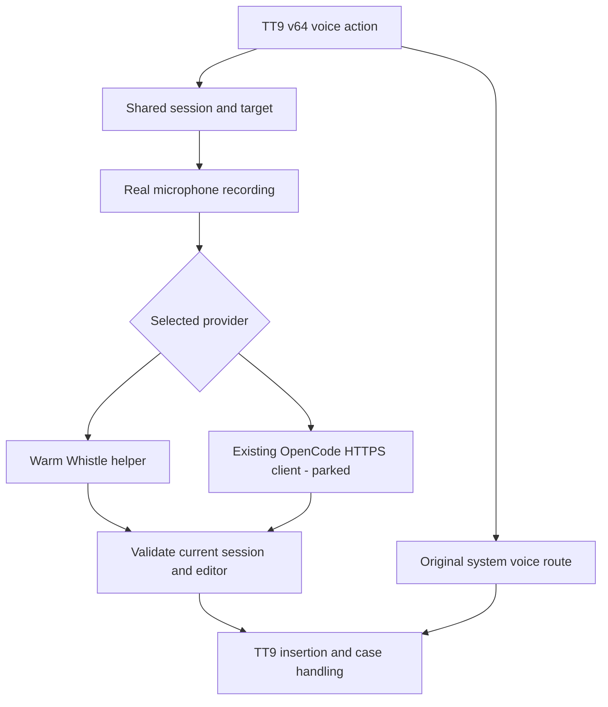
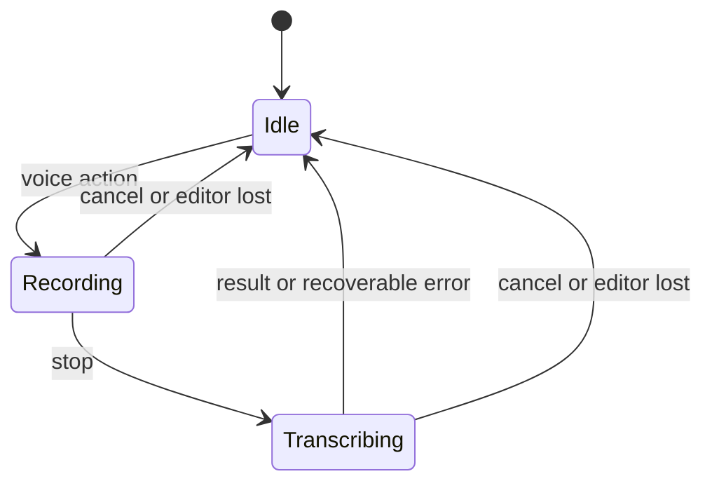

# TT9 v64 Qin Dictation - Plan

## Goal Capsule

- **Objective:** Max can comfortably type or dictate into everyday text fields on the Qin F22.
- **Means:** TT9 v64 with one shared dictation pipeline, a bundled Whistle runtime and a measured configuration (KTD1–KTD3, KTD5, KTD8). The OpenCode cloud adapter exists in the tree but is parked (U4).
- **Authority:** Current owner instructions and this Product Contract govern scope; the workspace device boundaries in `../../AGENTS.md` and `../../HANDOFF.md` remain binding.
- **Execution profile:** Preserve existing work, prove the microphone path early, deliver a usable phone build, then select the Whistle configuration from measured results. Max judges quality on the Mac test bench at `../../work/whistle-test/mac-app/` before anything is flashed to the phone (owner decision, 2026-10-16).
- **Stop conditions:** Do not write to an unidentified/disconnected phone, proceed through an unhealthy boot, publish private artifacts, or substitute fixture transcription for a real microphone test.
- **Delivery owner:** The implementing agent owns the build, reversible installation, verification and evidence. Max supplies real speech and judges the small-screen experience.

---

## Product Contract

### Summary

Use the TT9 v64 feature set as the keyboard base, add integrated dictation, and make its settings comfortable on the Qin's small screen.
This delivery ships the on-device Whistle engine and TT9's original system voice route; the OpenCode cloud adapter is written but parked (U4), so no cloud behaviour is claimed as accepted here.
Ship the configuration the bench measures as the most accurate (KTD5), and keep the Mac test bench as the way Max judges quality before a phone build is flashed.

### Problem Frame

The previous v34 fork built and was staged on the phone, but successful registration and real microphone-to-editor transcription were not verified.
Earlier emulator tests used supplied audio and could not establish usable speech capture.
Max also saw missing settings compared with v64, and wants the newer keyboard's capabilities, clearer menus and a measured balance of speed, accuracy and resource use.
The phone is now reported working again; the cause of its disappearance after the previous reboot remains unknown.
The v64 fork itself is no longer a plan: `feat/qin-v64-dictation` already carries the dictation pipeline, both transcriber adapters and the voice screens (28a7ad0e, hardened at 250fadf1). What remains is device verification, a recorded decision about which engine actually ships, and the measured configuration.

### Requirements

**Keyboard and dictation**

- R1. Base the fork on TT9 v64.0 and retain its features, languages, settings and keypad behaviour, except for the requested additive dictation and menu changes.
- R2. The voice action records the real microphone, stops on the next voice action and inserts the resulting text once at the original editor's cursor without sending it.
- R3. Cancellation, keyboard dismissal or an editor change suppresses subsequent insertion; failures leave the keyboard usable for retry and normal typing.
- R4. Silence produces no invented message, and legitimate speech is not removed by a phrase blacklist.

**Voice choices and personalisation**

- R5. Offer Whistle, OpenCode/MiMo and TT9's original system voice pathway; Whistle is the initial default and no automatic cloud fallback is allowed. The OpenCode engine is deferred for this delivery: it stays present and selectable, and no cloud behaviour is claimed as accepted (U4).
- R6. Provider selection reveals that provider's relevant settings, preserves independent saved values when switching, and shows readiness and recoverable errors. A failure that prevents transcription must be distinguishable from silence; `ERROR_AUDIO` and `ERROR_NO_MATCH` are currently treated as irrelevant to the user, so an engine that cannot run looks identical to a quiet room.
- R7. Whistle exposes measured performance choices with understandable speed/accuracy descriptions, English initially selected, and optional keyword hints only where the actual runtime supports them.
- R8. OpenCode offers key entry/import/removal, cleanup instructions and advanced endpoint/model fields, reusing the existing audio request contract; it must not require the standalone app. This exists at 28a7ad0e and its acceptance is deferred with U4; a cloud model that cannot read audio must be reported as a capability refusal rather than a generic engine error (`docs/evidence/2026-10-16-opencode-audio-models.md`).

**Small-screen experience**

- R9. Improve the settings' visual hierarchy and navigation for the actual Qin display, with readable text, clear D-pad focus, touch access, short labels and consistent Back behaviour.
- R10. All v64 settings remain reachable; disclosure of advanced controls reduces clutter without deleting functionality or silently resetting values.

**Performance and delivery**

- R11. Benchmark Whistle's supported configurations on the physical Qin using identical clips, reporting transcription accuracy, cold/warm delay and memory before choosing a default. The comparison that chose the shipped default ran on the Mac test bench with the same runner and model, which is how Max judges quality before a flash; the phone-side comparison is still outstanding.
- R12. Retain the loaded Whistle model between normal consecutive dictations where memory permits; release resources when appropriate and recover after process death.
- R14. Bundle English typing and English word-pair data for offline use; retain every other language choice with downloads available, avoiding the full dictionary payload on this phone.
- R13. Keep stock TT9 available, preserve its data, install reversibly, and verify the actual installed artifact and healthy boot before declaring delivery.

### Acceptance Examples

- AE1. Covers R2–R4, R6. Real speech in two ordinary editors inserts once; cancel, field changes and silence insert nothing; a recording the engine could not use surfaces as a distinguishable failure rather than an empty result.
- AE2. Covers R5–R8. Selecting OpenCode reveals its saved configuration; switching to Whistle hides cloud controls and makes no network request. The OpenCode screens stay reachable and state that cloud acceptance is deferred (U4), so AE2 does not gate this delivery.
- AE3. Covers R9–R10. On the Qin, Max can navigate settings, edit and save provider controls, and return using the keypad without clipped actions or losing focus.
- AE4. Covers R11–R12. Identical speech clips produce a report that exposes speed/accuracy/memory tradeoffs, and consecutive warm dictations do not reload the model each time. The report exists in part: `docs/evidence/2026-10-16-whistle-tuning.md`, with the raw runs under `../../work/whistle-test/evidence-2026-10-16/`.

### Scope Boundaries

- Include a bounded polish of native settings navigation, common preference presentation and the new voice screens; preserve the typing surface's existing behaviour.
- OpenCode is an optional network adapter, not a second bundled inference runtime or a new remote hosting service. It is written and parked; unparking it is a separate owner decision outside this delivery.
- No firmware, package-manager gate, boot image, browser/Play policy or unrelated app work.
- No automatic settings/database migration from stock TT9. The separate fork retains its own settings; use supported export/import where helpful and explain any manual setup.
- Do not add speculative CPU governors, system tuning, new background services or an automatic tuning wizard; benchmark during implementation and ship the measured choices.
- Defer streaming partial dictation, model training, a hosted Whistle endpoint, an arbitrary provider/plugin framework and the parked cloud engine (U4).

---

## Planning Contract

### Revision Note (2026-10-16 deepening)

This revision corrects the plan against the tree at 250fadf1. The deltas are named here, and the U4 deferral and the R6 clause are the only changes to the product contract:

- U2–U5 are built at 28a7ad0e. They are verify-and-harden units now, and every `(new)` file mark in the previous revision was wrong.
- The OpenCode cloud engine is moved out of this delivery into Deferred Work as U4, by owner decision: on-device Whistle only for now. R5 and R8 keep their IDs and now state the deferral.
- The invented `app/src/test` and `app/src/androidTest` seams are removed and replaced with the repository's real convention (`tests/<area>/run-tests.sh` plus `tests/<area>/mutation-control.sh`). Nothing is added to the product contract by this change.
- R6 gains one clause about distinguishable failure states; a new System-Wide Impact section and an Open Questions section are added. No other requirement changes meaning.

### Key Technical Decisions

- KTD1. **Port onto pinned v64.0, not the other way around.** Use upstream commit `e9f37e49ef9698cc78a61def709c191661e2fa25`. Preserve the dirty v34 tree and its artifacts before starting a separate implementation checkout. The original fork's voice classes must not replace v64's newer classes wholesale. Governs R1, R13. (session-settled: user-approved — chosen over v34: retain the newer TT9 options after checking Android compatibility.)
- KTD2. **One shared dictation controller with small provider adapters.** Reuse recording, session identity, silence handling, status and editor insertion for Whistle and OpenCode. Keep TT9's existing system-voice route intact behind the same selection UI; Android's system recognizer owns its own capture. Snapshot provider and target at session start. What the tree does today is narrower: `DictationEngine.start()` snapshots the engine only (`DictationEngine.java:122`), while depth, threads, language and keyword hints are read after recording stops (`DictationEngine.java:354-357`), so a settings change mid-session is honoured inconsistently. Make the snapshot cover every setting the session uses, or say plainly that it does not. Governs R2–R6.
- KTD3. **Retain the existing runner through an app-private FIFO.** The supported C API has no depth/thread controls, so do not add a native wrapper or call private C++ symbols. The runner loads its model before waiting on an ordinary WAV FIFO; this was proven on the Qin using a temporary root-owned pipe, and the app-UID path is confirmed on the emulator rather than on the phone, so the phone's own kernel remains unproven. Keep one idle prepared process, feed complete WAV on stop, reap it after the final result, then prepare the next idle process. Use nonblocking FIFO open/write, a bounded overall deadline and process cleanup to make cancellation safe. Low-memory callbacks release the idle process. Governs R3, R12.
- KTD4. **The OpenCode audio client is written and parked.** Owner decision 2026-10-16: on-device Whistle only for now; the cloud path is deferred, so nothing here gates this delivery. The adapter already exists at 28a7ad0e (`OpenCodeTranscriber`, `OpenCodeSettings`) as a port of the proven contract in `../qin-dictation/src/main/java/au/max/qindictation/TranscriptionClient.java`, with its own Keystore alias, thinking-disabled requests, bounded timeouts, cancellation and HTTPS credential handling. Unparking it is a new owner decision, and it means: adapt rather than redesign, keep the endpoint HTTPS-only, and report a model that cannot read audio as a capability refusal instead of a generic engine error (`docs/evidence/2026-10-16-opencode-audio-models.md`). Governs R5, R8.
- KTD5. **Tune the same Whistle weights through supported runner controls, and describe measured axes rather than a ladder.** The retained model accepts speech depths 2–8, with 8/full equivalent, and `--threads` accepts excessive values without validation; clamp to 2–8 and 0/auto or 1–4. Measured on the reference clip, depths 2/4/6/8 produced 2/0/1/2 word errors (`../../work/whistle-test/evidence-2026-10-16/depth-comparison-clip.json`), and over 13 clips at 4 threads, 69/54/57/54 errors per 930 reference words (`docs/evidence/2026-10-16-whistle-tuning.md`). Depth 4 is the most accurate of the four and the cheapest way to get it; depth 2 is the fastest and about 28% less accurate; depth 8 loses capitalisation and punctuation on long takes. Deeper is not more accurate here, so describe depth as the measured trade it is: word accuracy, wall clock, and digit/formatting behaviour. Keep the shipped default (`DEPTH_DEFAULT = 4`, 4 threads) and keep depth 2 visible as the faster, less accurate alternative. Verify app-UID warm timings before claiming a warm-path gain. Governs R7, R11.
- KTD6. **Native compact settings, not a web UI.** Extend v64's preference screens and shared theme: restrained neutral surfaces, one accent, strong type hierarchy and visible focus. Use a single column, short primary labels and concise current-value summaries. Put Voice input near the main keyboard settings, with a provider chooser followed by provider controls and a separate Advanced screen for infrequent edits. Derive dimensions from the Qin's measured dp viewport and font scale, not assumed physical pixels. Governs R6, R9–R10.
- KTD7. **No hidden audio transfer, and a trust boundary stated out loud.** Whistle remains offline with runner telemetry disabled or absent in the pinned build. Recordings reach disk nowhere in either engine: PCM stays in memory and the per-call `cacheDir` needle wav is deleted in a `finally` (`LocalWhistleTranscriber.java:98`). OpenCode clearly states that recordings go to the configured endpoint, the endpoint must be HTTPS, and credential-bearing redirects are not followed. Keyword hints do persist as plaintext at `filesDir/whistle/keywords-<digest>.txt`. A local transcription shim binds `0.0.0.0` unauthenticated, so it is a development tool rather than a shipping configuration. Never fall back between providers automatically. Do not log keys, transcripts or audio; private fixtures are retained only for deliberate testing. Governs R5, R8, R13.

- KTD8. **Keep v64 functionality with compact language packaging.** The loader tries bundled ZIPs before remote downloads in either flavor. Build the lite flavor with English dictionary/ngrams bundled and the full shared language metadata. Use the official v64 generated assets, validated against SHA-256 `b13b93a129d945996b5c2b9dec7a9fd660cd26bf8855cfdb7a4780624d349bda`, rather than regenerating dictionaries during iteration. No other keyboard feature depends on the LITE flag. Governs R1, R14.

### Existing Evidence and Technical Constraints

- `../tt9-fork/CURRENT_STATE.md`, `../tt9-fork/README.md` and `../../HANDOFF.md` describe the earlier v34 fork, deployment checksum and unverified post-reboot state. They are historical evidence, not proof the current device is ready.
- v64 `app/build.gradle` declares minSdk 24, compile/target SDK 37 and AGP 9.3.1; its wrapper is Gradle 9.5.0. Use the supported JDK and SDK combination for those pinned versions during implementation, preserving the upstream build rather than lowering requirements casually.
- v64 `ime/voice/VoiceInputOps.java` adds a provider picker, partial results and legacy/modern support; `ime/VoiceHandler.java` applies case handling and has changed inheritance. Preserve those paths and adapt only the Whistle/OpenCode integration.
- Retained native assets are in `../../work/whistle-test/bin/` and `../../work/whistle-test/models/`; the ARMv7 static library exists, but linking it into a persistent helper and running it from the app UID are untested.
- Existing cloud evidence is in `../qin-dictation/TESTING.md`, `../qin-dictation/LATENCY_NOTES.md` and `LATENCY_REPORT.md`. Endpoint viability is settled; copying credentials, changing request behaviour or citing old latency as current proof is not justified.
- The Qin was last verified as Android 11, 32-bit ARM and slot a. Phone compatibility must be checked again at implementation time. During the owner-authorized experimental continuation, Android 11/build 66.0.3, healthy boot/root, charging and the 480x640/208 dpi display were rechecked; the existing Android 11 emulator was also resized to match. The benchmark evidence is under `../../work/whistle-test/evidence-2026-10-16/`. Discard root-polling warm timings: Magisk logging created measurement load; retain only the FIFO feasibility result until app-UID timing is available.
- U2–U5 are built. Commit 28a7ad0e added `DictationEngine`, `PreparedWhistleTranscriber`, `OpenCodeTranscriber`, `OpenCodeSettings`, nine preferences/screens/dictation files and `res/xml/prefs_screen_dictation.xml`. Treat those units as verify-and-harden.
- The previous revision's test seams do not exist and would not run: `app/src/test` and `app/src/androidTest` are absent and `app/build.gradle` declares no test dependency. The repository's convention is `tests/<area>/run-tests.sh` plus `tests/<area>/mutation-control.sh`, where the mutation control copies a hardcoded source list into a temporary tree and asserts that each injected defect is caught. That is why `tests/whistle/mutation-control.sh` names its four dictation files explicitly instead of discovering them.
- Every evidence file the previous revision names is absent: `docs/evidence/v64-baseline.md`, `docs/evidence/whistle-qin-benchmark.md`, `docs/evidence/qin-v64-acceptance.md`, and `tests/whistle/benchmark.py` with its manifest. What exists instead: `CURRENT_STATE.md` holds the baseline, the done/verified/open state and the artifact hashes; `docs/evidence/2026-10-16-whistle-tuning.md` and `docs/evidence/2026-10-16-opencode-audio-models.md` hold the measurements; `tests/whistle/probe_fifo.py` is the FIFO probe; and the bench output sits under `../../work/whistle-test/`.
- The Mac test bench is `../../work/whistle-test/mac-app/`, and every take is kept under `../../work/whistle-test/takes/` as a `.wav` plus a `.json` of settings, levels, timings and transcript. `../../work/whistle-test/whistle-mic.sh` drives the shipped runner and model directly with no app in between. This is how Max judges quality before a phone build is flashed.
- Latest emulator verification, 2026-10-16 after 250fadf1: the keyboard-hide fix works (`mInputShown` true on focus, false after Back) and local dictation produces text end to end; `tests/emulator/dictation-e2e.sh` reproduces that path through the debug clip feed.
- Limits the previous revision never stated, all of them in the current tree: `DictationEngine.MAX_RECORD_MS = 60_000L` silently ends a recording at 60 s; `PreparedWhistleTranscriber.DEADLINE_MS = 30_000L` bounds the runner-death wait; the silence gate is `SILENCE_PEAK = 655` of 32768, about -34 dBFS, and anything quieter is reported as no speech. A second voice press while transcribing cancels the session and discards the recording and the in-flight result (`ime/voice/VoiceInputOps.java:176`). None of these is a user-visible setting today.
- Nothing is retained on disk: PCM stays in memory, the per-call `cacheDir` needle wav is deleted in a `finally`, the model lands at `filesDir/whistle/whistle.cact`, keyword hints at `filesDir/whistle/keywords-<digest>.txt`, and the runner is `libneedle.so` from `nativeLibraryDir`.
- Failures reach the user as nothing: `VoiceInputError.isIrrelevantToUser()` swallows `ERROR_AUDIO` and `ERROR_NO_MATCH` (`ime/voice/VoiceInputError.java:41`), and `DictationEngine` maps a mic-read failure, the silence gate and an empty transcript onto exactly those codes (`DictationEngine.java:273`), so an engine that cannot run is indistinguishable from a quiet room.

### Technical Shape

Terminal callbacks recheck session identity on the main thread immediately before insertion, including callbacks queued after cancellation.
The original field may be revisited later, so package/field ID equality alone is insufficient to validate the editing session.
The OpenCode branch is drawn because the code path exists at 28a7ad0e; it is parked at U4 and carries no acceptance claim in this delivery.

## System-Wide Impact

Dictation reaches into the IME lifecycle, not only the voice key. The previous revision named none of these surfaces, and the regression it missed lived exactly here.

- `VoiceHandler.onFinishInputView()` (`ime/VoiceHandler.java:44`) releases the warm engine when the keyboard hides. The release used to run inline: `DictationEngine.releaseResources()` called `PreparedWhistleTranscriber.release()`, which kills the idle runner and waits for it to die, from a main-thread callback. Hiding the keyboard stalled. Fixed at 250fadf1 by submitting the release to the same serial worker that starts the runner, so the two cannot interleave and no lifecycle callback waits on a process teardown.
- `TraditionalT9.onStartInputView()` re-warms the runner, which is where dictation becomes possible again after a release. A show/hide cycle is therefore two engine transitions, and both must stay non-blocking.
- `onStartInput()` and the `EditorInfo` identity decide where text may land: `VoiceInputOps.customTarget` is captured at session start and compared against `service.getCurrentInputEditorInfo()` before insertion, so a terminal callback queued after a cancel or an editor change cannot write into the wrong field.
- The system-voice branch owns a separate `SpeechRecognizer` lifecycle inside `VoiceInputOps.start()` / `cancel()`. Cancellation, keyboard dismissal and an editor change must suppress insertion on both branches.
- Readiness outlives a single dictation and is never checked before recording: `VoiceInputOps.isAvailable()` short-circuits to `true` for any custom engine (`ime/voice/VoiceInputOps.java:117`), so the voice key never shows as unavailable even when the model or runner is missing.
- Shipped revision identity is part of the surface. U1 preserves existing data, so `pref_voice_engine` survives in place, which is how the shipped build came to run the never-tested OpenCode engine. Fix and record the engine that actually ships before any acceptance claim (U1, U6).

---

## Implementation Units

U2–U5 were built at commit 28a7ad0e and hardened at 250fadf1, so they are verify-and-harden units: the goals, scenarios and verification below stand, and their Files lists name what exists rather than what is to be created. U4 is moved out to Deferred Work.

### U1. Preserve work and establish the v64 base

**Goal:** A separately identifiable v64 fork builds without losing existing work.
**Requirements:** R1, R13, R14; KTD1, KTD8.
**Dependencies:** None.
**Files:** `app/build.gradle`, `build.gradle`, `gradle/wrapper/gradle-wrapper.properties`, `app/src/main/AndroidManifest.xml`, `app/src/main/res/xml/prefs.xml`, `make-module.sh`, `README.md`, `CURRENT_STATE.md`, `docs/evidence/upstream-v64-assets.json` (all existing).
**Approach:**

1. Preserve the dirty v34 checkout and record its hashes; use the separate local `tt9-whistle-v64` clone on a feature branch from the pinned upstream base.
2. Keep the side-by-side package identity and signing continuity so the existing fork can update without deleting its data. Audit hardcoded package references in intents, setup checks and v64's provider authority.
3. Build the compact release per KTD8 and make module generation derive its version and native assets from that artifact.
4. Fix and record the engine that actually ships. U1 preserves existing data, so `pref_voice_engine` survives an upgrade in place, and the shipped build ran the never-tested OpenCode engine for that reason alone. Confirm the stored engine on the device and in the build, then record it before any acceptance claim.

**Patterns:** v64 build/version scripts and current single-app module packaging.
**Test scenarios:** Release metadata identifies v64 and the fork; native code includes ARMv7; internal Help, Privacy, setup and picker intents resolve to the fork; stock TT9 remains separately available; the installed build's default engine is the one the plan claims, not a value inherited from a preserved preference row.
**Verification:** Successful release build, signature/ABI checks, and an explicit inventory mapping upstream settings entries to reachable fork entries. Packaging smoke checks are more useful than implementation-mirroring unit tests here. `CURRENT_STATE.md` is the baseline record for this unit and holds the artifact hashes; the `docs/evidence/v64-baseline.md` named by the previous revision does not exist.

### U2. Port real microphone dictation and session safety

**Built at 28a7ad0e; verify and harden.**

**Goal:** Actual speech captured from the keyboard reaches the intended editor safely.
**Requirements:** R2–R4; AE1; KTD2.
**Dependencies:** U1.
**Files:** `app/src/main/java/io/github/sspanak/tt9/dictation/DictationEngine.java`, `dictation/Transcriber.java` under the same Java package, `ime/voice/VoiceInputOps.java`, `ime/VoiceHandler.java`, `ime/TraditionalT9.java`, `tests/whistle/run-tests.sh`, `tests/whistle/mutation-control.sh`, `tests/emulator/dictation-e2e.sh` (all existing).
**Approach:**

1. Adapt the current MIC/16 kHz recorder and terminal callbacks to v64's insertion/case handling, preserving its original system route.
2. Keep the current CLI runner as an initial baseline to prove microphone capture before replacing the runtime in U3.
3. Correct any observed lifecycle failures at the shared controller rather than duplicating safety logic in each provider. Keep fixture injection debug-only and visibly distinguish settings tests from recording.
4. Widen the session snapshot per KTD2, and make the failure path distinguishable per R6: a mic-read failure, the silence gate and an empty transcript must not all arrive as the same silent no-op.

**Test scenarios:**

- Covers AE1. Permission grant followed by real speech inserts once in each of two ordinary fields.
- Covers AE1. Cancel during recording, inference and a queued callback inserts nothing; switching fields and returning to the same field does not revive an old result.
- Silent audio returns no speech; a legitimate utterance containing “thank you” is not blacklisted.
- Missing mic permission, unavailable audio device and transcription failure show recoverable status; typing and a subsequent dictation still work. A custom engine whose model or runner is missing must not report itself as available, which today it does (`VoiceInputOps.isAvailable()` short-circuits to `true`).
- Covers R6. A mic-read failure, the silence gate and an empty transcript reach the user as distinguishable outcomes rather than three identical silent no-ops.
- A second press while transcribing cancels the session and discards the recording and the in-flight result; the next press starts cleanly. A recording that reaches the 60 s `MAX_RECORD_MS` cap is transcribed rather than lost, and a runner that will not die inside the 30 s `DEADLINE_MS` leaves the keyboard responsive.

**Verification:** A named real-microphone phone check plus ordinary keypad typing. Run the repository harness rather than the seams the previous revision invented: `tests/whistle/run-tests.sh`, `tests/whistle/mutation-control.sh` (hardcoded source list; it must catch every injected defect), and `tests/emulator/dictation-e2e.sh` for the lifecycle path. `app/src/test` and `app/src/androidTest` do not exist and would not run. Fixture-only/emulator evidence cannot complete this unit's mic requirement.

### U3. Keep Whistle warm and select a measured performance profile

**Built at 28a7ad0e; the default is measured and shipped, so this unit is now verify-and-harden.**

**Goal:** Choose the fastest useful Whistle configuration without hiding accuracy or memory costs.
**Requirements:** R7, R11–R12; AE4; KTD3, KTD5.
**Dependencies:** U2.
**Files:** `app/src/main/java/io/github/sspanak/tt9/dictation/LocalWhistleTranscriber.java`, `app/src/main/java/io/github/sspanak/tt9/dictation/PreparedWhistleTranscriber.java`, `app/src/main/java/io/github/sspanak/tt9/dictation/DictationSettings.java`, `app/build.gradle`, `tests/whistle/run-tests.sh`, `tests/whistle/mutation-control.sh`, `tests/whistle/PreparedWhistleArgumentsTest.java`, `tests/whistle/PreparedWhistleLifecycleTest.java`, `tests/whistle/PreparedWhistleResultTest.java`, `tests/whistle/probe_fifo.py`, `../../work/whistle-test/tune/run-matrix.sh`, `../../work/whistle-test/mac-app/`, `docs/evidence/2026-10-16-whistle-tuning.md` (all existing).
**Approach:**

1. Confirm the pinned runner/header/model provenance and its speech-specific controls. The public C API does not expose depth or threads; use the runner per KTD3 rather than assuming new setters.
2. The prepared-runner lifecycle per KTD3 is implemented. The app-UID FIFO path is confirmed on the emulator (`CURRENT_STATE.md`: a resident `libneedle.so` process owned by `u0_a169` with its FIFO in the app's own cache directory), while the Qin's own kernel remains unproven; the root-only feasibility experiment stays the weaker evidence.
3. Benchmark supported audio depths of one model, then warm versus per-call loading. That benchmark has run: a 27-run screen and a 117-run expansion, reported in `docs/evidence/2026-10-16-whistle-tuning.md` with raw runs under `../../work/whistle-test/evidence-2026-10-16/`. Extend it rather than replacing it, and add other runtime knobs only if the pinned engine really supports them and the comparison answers a measured bottleneck.
4. Package only the selected weights/runtime and small profile configuration; do not ship all benchmark candidates. The selection is made: depth 4 and 4 threads. Make profile descriptions reflect measurements, not generic Fast/Balanced/Accurate labels without evidence.

**Benchmark protocol:** Use at least 12 reference-transcribed clips spanning short/long dictation, natural fillers, names/numbers, quiet speech and noise, plus separate silence fixtures. Include several real Qin microphone recordings and keep a small held-out subset unused for choosing the setting. Repeat each supported candidate at least three times in interleaved order; separate cold startup from warm runs. Record median/p95 stop-to-result time, model load time, combined IME/helper PSS and peak memory, failures, normalized word error rate, and errors in names/numbers/negation. Log only timings and scores in routine app diagnostics. What has actually run so far is 13 clips, of which every one is synthetic text-to-speech; real Qin recordings are still missing, and depth 4 is recommended on that synthetic evidence.

**Selection rule:** Reject crashes, unstable memory use, silence insertion and meaning-changing errors in the representative acceptance phrases. Among useful stable candidates, choose a Pareto-efficient default with the lowest warm delay at comparable accuracy. If a materially faster setting loses accuracy, retain it as an explicit alternative rather than silently choosing it. Report the tradeoff to Max when no candidate clearly balances both; do not manufacture a single winner from tiny WER differences. Applied to the measurements: depth 4 wins on accuracy and is cheaper than depth 8, and depth 2 stays visible as the faster, 28% less accurate alternative. The ladder claim in the previous revision is withdrawn.

**Test scenarios:**

- Covers AE4. Two consecutive jobs use the same loaded model; a new process or changed depth reloads predictably.
- Worker death, malformed output and timeout leave the keyboard responsive; cancelled work never inserts late and a subsequent job can recover.
- Profile selection persists, depth outside 2–8 and threads above four are rejected or restored to a valid saved choice, and process-global calls do not overlap.
- Covers R7. The depth control's description states a measured trade rather than a quality ladder: 2/4/6/8 measured 2/0/1/2 word errors on the reference clip, so the shipped default is the most accurate setting rather than the deepest one.
- Low-memory teardown releases the helper; next dictation can reload. The benchmark includes normal typing/app switching alongside the warm helper.

**Verification:** Reproducible score table and hashes in `docs/evidence/2026-10-16-whistle-tuning.md`, with the harness in `../../work/whistle-test/` and the warmed-run checks in `tests/whistle/`. The default is explained; real-microphone evidence from the Qin and app-UID warm-path timings on the phone are still outstanding. Do not promise a specific speedup before measurement.

### U4. Add the optional OpenCode adapter using existing code — deferred

Moved to Deferred Work below by owner decision of 2026-10-16: the cloud engine is parked, so U4 is not part of this delivery.

**Deferred.** Goal, requirements, approach, scenarios and cloud-model evidence are all preserved under Deferred Work.

**Deferred.** The offline client suites still exist in `tests/opencode/`; the phone acceptance stays deferred with the unit.

### U5. Make settings beautiful and practical on the Qin

**Built at 28a7ad0e; verify and harden.**

**Goal:** Max can discover, choose and tune voice input comfortably without losing TT9 functionality.
**Requirements:** R5–R10; AE2–AE3; KTD6.
**Dependencies:** U1, U3 (U4 is deferred and no longer a dependency).
**Files:** `app/src/main/java/io/github/sspanak/tt9/preferences/PreferencesActivity.java`, `preferences/screens/main/MainSettingsScreen.java`, `preferences/screens/dictation/DictationScreen.java`, `preferences/screens/dictation/DictationAdvancedScreen.java`, `app/src/main/res/xml/prefs.xml`, `app/src/main/res/xml/prefs_screen_dictation.xml`, `app/src/main/res/layout/preferences_container.xml`, `app/src/main/res/values/styles.xml`, `app/src/main/res/values/colors.xml`, `app/src/main/res/values/dimens.xml`, corresponding night resources, `app/src/main/res/values/strings.xml`, plus `tests/emulator/dictation-e2e.sh` and `docs/evidence/screens/` for the rendered-state checks. The `app/src/androidTest/.../VoiceSettingsNavigationTest.java` named by the previous revision does not exist and could not run; settings verification is screenshot-and-keypad evidence on the emulator and the phone.
**Approach:**

1. Present Voice input with the current provider summary. Its first row selects provider; the rest shows only controls for that selection. Profile descriptions explain measured tradeoffs in ordinary language.
2. Whistle shows readiness, performance profile and supported language/hints. OpenCode shows key status, cleanup and connection test, with endpoint/model under Advanced, and states that cloud acceptance is deferred (U4). System voice retains v64's provider/setup facilities.
3. Apply a restrained native theme to main menus and shared rows. Keep compact spacing without shrinking text or making controls difficult to activate. Prefer full-screen scrollable edit screens to cramped dialogs for keys and cleanup text.
4. Show clear recording/transcribing/error/ready states; a provider test states whether it uses a fixture or records the microphone. Save/cancel is explicit, Back restores the prior focus and validation does not erase edits.

**Test scenarios:**

- Covers AE2–AE3. Provider changes update controls and summaries, preserve values, and restore focus after returning from a child screen.
- All controls can be reached with D-pad/confirm/Back; touch and larger font remain usable on the measured smallest viewport.
- Empty, key-needed, model-loading, test-running, success and failure states remain legible without clipped actions in light and dark mode, and the failure state is distinguishable from silence (R6).
- Full v64 settings inventory remains reachable, including Help/Privacy and setup, after the visual changes.

**Verification:** Actual-phone screenshots and keypad navigation through main settings, all provider screens, Advanced and editing states. Max's visual feedback guides bounded polish; avoid a broad keyboard visual rewrite.

### U6. Install and prove the finished phone workflow

**Goal:** Deliver a verified build and an accurate recovery/handoff record.
**Requirements:** R1–R14; AE1–AE4.
**Dependencies:** U3, U5 (U4 is deferred).
**Files:** `make-module.sh`, `README.md`, `CURRENT_STATE.md`, `docs/evidence/qin-v64-acceptance.md` (to be created), `../../HANDOFF.md`.
**Approach:** First, fix and record the engine that actually ships; the preserved `pref_voice_engine` is why the shipped build ran the never-tested OpenCode engine, and no acceptance run is valid until the shipped engine is the one being tested. Then reidentify the phone and inspect build/slot/root/boot/module flags, battery/charging and free space. Inspect whether the previous module is present/enabled before staging an update. Save previous keyboard selection, module state, APK/signing hashes and rollback material. Activate one reversible module and verify the mounted artifact, package registration and healthy boot before selecting it. Keep the known disabled Play/stock masks disabled and preserve Play licensing. If the phone disappears or boot is unhealthy, prioritise diagnosis/rollback rather than another installation attempt.
**Test scenarios:** Covers AE1–AE4 as they apply to the on-device engine. Verify real dictation in two editors for Whistle, the distinguishable failure path, stock system-voice regression where available, hardware voice shortcut, ordinary T9, cancel/field change, silence, retry, settings persistence and restart. OpenCode acceptance is deferred with U4 and is not part of this run. Verify stock TT9 is still selectable and the new module can be disabled without losing its data.
**Verification:** Owner can use the selected keyboard and test it personally; evidence names the exact installed version, the engine that ships and the measured configuration, plus any remaining limits. No success claim based only on copying files, a green build, fixture transcript or HTTP 200.

---

## Deferred Work

### U4. Add the optional OpenCode adapter using existing code

**Deferred by owner decision, 2026-10-16: on-device Whistle only for now.** The adapter already exists at 28a7ad0e, so nothing here is work in flight; unparking it is a new owner decision. What follows records what exists and what unparking would mean.

**Goal:** Enable cloud dictation without a second local model/runtime.
**Requirements:** R3–R6, R8; AE2; KTD2, KTD4, KTD7.
**Dependencies:** U2.
**Files (all existing):** `app/src/main/java/io/github/sspanak/tt9/dictation/OpenCodeTranscriber.java`, `dictation/OpenCodeSettings.java`, `dictation/DictationSettings.java`, `dictation/DictationEngine.java`, `app/src/main/AndroidManifest.xml`, `tests/opencode/run-tests.sh`, `tests/opencode/mutation-control.sh`, with `Fakes.java`, `Fixtures.java`, `Harness.java` and `android/util/Base64.java` beside them. The `(new)` marks and the `app/src/test/.../OpenCodeClientTest.java` seam in the previous revision were both wrong.
**Approach (done):** The platform HTTPS client, encrypted settings and cancellation sit behind the shared controller. The key is imported deliberately into fork-owned storage, trimmed before encryption and confirmed by fingerprint only. The WAV request and thinking-disabled configuration are retained, and endpoint editing does not follow credential-bearing redirects or embed credentials. Before any future ship: re-run the ported scenarios from `../qin-dictation/tests/client/ClientIntegrationTest.java`, keep the endpoint HTTPS-only, and treat a model that cannot read audio as a capability refusal rather than a generic engine error (`docs/evidence/2026-10-16-opencode-audio-models.md`).

**Test scenarios (present in `tests/opencode/`):**

- A known fixture reaches a controlled test endpoint with the configured cleanup instructions; only final text is returned.
- Covers AE2. Whistle selection makes zero cloud requests; choosing OpenCode without a key reports setup needed without breaking typing.
- 401/403, timeout, cancellation, truncated/malformed responses and endpoint validation produce distinct recoverable outcomes; no key appears in logs.
- Switching provider during a pending session cancels it; the new provider uses its own saved settings on the next recording.

**Verification (offline part done):** 121 checks pass across the three `tests/opencode` suites, and `tests/opencode/mutation-control.sh` caught all five injected defects, as recorded in `CURRENT_STATE.md`. Real mic-to-editor cloud dictation has never run on a phone, and that acceptance is what stays deferred. Model availability, if this is ever unparked: `mimo-v2.6-pro` transcribes audio correctly, `mimo-v2.6-flash` refuses it with HTTP 400 `unsupported_content_type`, and five further ids were never tested (`docs/evidence/2026-10-16-opencode-audio-models.md`).

---

## Verification Contract

- Build the compact v64 release using its pinned Gradle toolchain and validated generated assets; run the relevant release lint tasks and signature/ABI checks. Do not silently inherit the previous lint exclusions.
- Use the repository's existing harness: `tests/whistle/run-tests.sh` and `tests/whistle/mutation-control.sh`, `tests/opencode/run-tests.sh` and its mutation control, `tests/java/`, and `tests/emulator/dictation-e2e.sh`. `app/src/test` and `app/src/androidTest` do not exist and `app/build.gradle` declares no test dependency, so the seams the previous revision invented cannot run.
- Use the session, worker and client suites for deterministic contracts. Use emulator evidence for UI and lifecycle coverage, and physical Qin evidence for real mic, native execution, memory and hardware navigation. The mutation harnesses copy a hardcoded source list, so a new source file joins the list by hand or it is not covered.
- The repeatable benchmark harness is the existing `../../work/whistle-test/` tree: `tune/run-matrix.sh` with `tune/matrix.py`, `evidence-2026-10-16/screen.py` and `extended.py`, `probe_fifo.py` under `tests/whistle/` for the FIFO, and `mac-app/` for recorded takes. `tests/whistle/benchmark.py` and its manifest do not exist.
- Installation and acceptance results belong in the named evidence files with hashes and dates; retain recordings and credentials privately outside any proposed public commit set.
- Fix and record the engine that actually ships before any acceptance claim. The preserved `pref_voice_engine` value is why the shipped build came to run the never-tested OpenCode engine.
- Verify the distinguishable failure path (R6) on the phone rather than only that success works; a mic-read failure, the silence gate and an empty transcript currently reach the same codes the UI hides.

---

## Definition of Done

- U1: The isolated v64 fork builds and retains upstream settings and stock TT9 alongside it.
- U2 (built at 28a7ad0e): actual microphone speech inserts safely, with no fixture substituted for real capture; the outstanding item is the phone proof, not the implementation.
- U3 (built and measured at 28a7ad0e): depth 4 with 4 threads ships as the most accurate measured setting, depth 2 stays available as the faster alternative, and the memory and formatting tradeoffs are documented; warm-path timing on the phone is still outstanding.
- U4 (deferred): not required for this delivery. Its offline contract suites pass and its phone acceptance is deferred by owner decision; unparking it is a new decision.
- U5 (built at 28a7ad0e): the owner can navigate and edit attractive, readable provider settings on the phone's actual display; the on-phone navigation pass is still outstanding.
- U6: The shipped engine is fixed and recorded, and installed-artifact identity, post-reboot health, rollback and two-editor acceptance are verified and documented.
- Remove abandoned experiments and release test hooks, preserve unrelated work, keep binaries/model provenance and applicable notices, and accurately name any incomplete requirement rather than declaring completion.

---

## Open Questions

- The real phone's microphone gain has never been measured. Every level figure comes from the Mac or the emulator, so `SILENCE_PEAK = 655` (about -34 dBFS) and the thresholds in `../../work/whistle-test/evidence-2026-10-16/level-vs-accuracy.md` are unanchored on the device and could gate real speech.
- Whether any endpoint model beyond the tested ids accepts audio: `mimo-v2.6-pro` does, `mimo-v2.6-flash` does not, and five further ids were never tested. This matters only if U4 is unparked (`docs/evidence/2026-10-16-opencode-audio-models.md`).
- App-UID warm-path timings on the phone: the FIFO path is confirmed on the emulator under the app UID, but no stop-to-result timing has been taken on the Qin's own kernel, so the warm-path gain is unproven there (`CURRENT_STATE.md`).
- Whether keyword hints deserve to be presented as a headline setting: in the one measurement taken they recover single names but not multi-word phrases, and a second sentence carrying a common name was not fixed (`CURRENT_STATE.md`).
- `PreparedWhistleTranscriber.transcript()` maps any parse failure whose message contains "no text" to an empty transcript, so a truncated runner response reports as silence rather than as an error; this is recorded as deliberately left undone in `CURRENT_STATE.md`.

---

## Sources

- [TT9 v64 source](https://github.com/sspanak/tt9/tree/v64.0), particularly the versioned build, preference and voice classes.
- [Whistle model documentation](https://huggingface.co/Cactus-Compute/whistle): one model family, selectable audio decoder depth; published benchmark hardware is not the Qin.
- [Needle runtime documentation](https://github.com/cactus-compute/needle): shared runtime, C API and platform artifacts.
- `../../docs/solutions/workflow-issues/qin-f22-owner-control.md` and `../../docs/solutions/workflow-issues/qin-f22-adb-install-gate-decompiled.md`: reversible deployment and the restricted package-command surface.
- `../qin-dictation/src/main/java/au/max/qindictation/TranscriptionClient.java` and `SettingsStore.java` in that same directory: reusable cloud contract and encrypted storage.
- `CURRENT_STATE.md` in this repository: the baseline, the done/verified/open state, artifact hashes and the recorded gaps.
- `docs/evidence/2026-10-16-whistle-tuning.md` and `../../work/whistle-test/evidence-2026-10-16/`: the measured depth and thread comparison and its raw runs.
- `docs/evidence/2026-10-16-opencode-audio-models.md`: which endpoint models actually read audio.
- `../../work/whistle-test/mac-app/` and `../../work/whistle-test/takes/`: the Mac test bench and its retained takes.
- `../../AGENTS.md` and `../../HANDOFF.md`: the device and publication boundaries that govern any install work.
